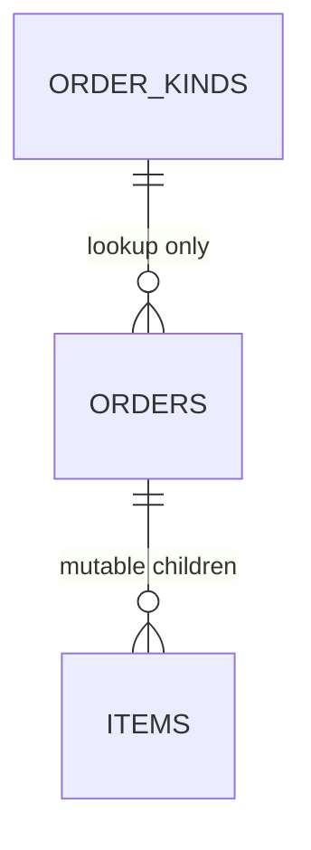

## Describe the writable graph

### Queue one statement, optionally retaining its inserted identity

For a single static INSERT, UPDATE or DELETE that does not return an identity,
use the existing buffered `Execute` call. Its arguments are typed scalar
Input/Output fields in SQL placeholder order:

```sql
#package('pkg/constraints')
#setting($_ = $route('/constraints/{type}', 'PATCH'))
#define($_ = $ConstraintType<int>(path/type))
#define($_ = $Identity<int64>(output/body))

$dml.Execute("UPDATE constraints SET audience_ids = '' WHERE type = ?", $Input.ConstraintType)
```

Run `datly transcribe patch` with the normal source and destination options.
This queues the authored bulk statement rather than reading identities and
rewriting it as individual row updates. The normal root completion owns its
transaction and reports execution failures; a child does not commit or flush.
`Execute` does not populate `Identity` or expose a rows-affected result.

For a route whose write is one static INSERT, operation-based transcription can
generate a typed buffered statement handler. Declare scalar inputs and a signed
integer output destination, then author the statement in DQL:

```sql
#package('pkg/records')

#setting($_ = $route('/records/{name}', 'PATCH'))

#define($_ = $Name<string>(path/name))
#define($_ = $Identity<int64>(output/body))

$dml.ExecuteWithResult("INSERT INTO records(name) VALUES (?)", $Output.Identity, $Input.Name)
```

Run `datly transcribe patch` with the normal source and destination options.
Generation preserves this route's lack of a request body. An optional single
SELECT graph can supply SQL-derived output shapes; its wildcard fields evolve
when the authoring schema changes and the component is regenerated. That graph
does not add a second persistence owner or an automatic response read.

The generated handler binds the invocation's existing DML capability and queues
the exact SQL and typed arguments. Root completion executes it in journal order
using the existing shared buffer and transaction. The statement's `LastInsertId`
is checked for signed overflow and assigned before output finalization,
independently of `RowsAffected`. Application input initialization and validation
and output finalization use the normal contract lifecycle. An injected child
does not flush the caller's buffer.

`ExecuteWithResult` accepts one static INSERT with one explicit VALUES row,
scalar Input/Output field arguments, and an addressable signed integer identity
destination. `Execute` accepts one static INSERT, UPDATE or DELETE with scalar
field arguments and no result destination. Both reject dynamic SQL, multiple
writes, transaction control, DDL, record sequencing,
reconciliation, identity/action policies, entity hooks and mutation tokens.
It does not allocate IDs, classify inserts versus updates, retry statements,
or query an identity afterward. Other writable graphs continue to use their
existing generated mutation policy.

Use `ExecuteWithOptionalResult` only when the source contract permits an
unavailable inserted identity. It accepts the same static INSERT and destination
as `ExecuteWithResult`. A `LastInsertId` extraction error or nonpositive ID leaves
the destination unchanged; a positive ID uses the same checked assignment.
SQL execution, overflow, cancellation and transaction completion errors still
fail normally. The default `ExecuteWithResult` remains strict. Optional result
handling adds no identity query or retry; any existing conditional fallback
belongs to the application after successful completion.

Arguments may also be one pointer to a supported scalar, including `*time.Time`.
A nil pointer binds SQL NULL; a nonnil pointer binds its value, including zero.
The original pointer is queued without dereferencing or snapshotting, so keep
its target stable until the caller completes the buffer. Pointer identity
destinations, double pointers, records and collections remain unsupported.

### Typed buffered updates

For an existing typed record update, use the canonical two-selector statement:

```sql
$dml.Update($Input.Table, $Input.Row)
```

Declare Table as a string input and Row as a pointer to the existing named record
using its qualified type/import. Transcription generates a call to the existing
`Update(string, any) error` capability, retaining the original record pointer,
SQLX mapping, sparse Has markers and NULL values. It adds no reads, allocation,
classification, flush or transaction owner. The queued record is observed using
the existing runtime timing; do not mutate it after the application has finalized
its intended values.

Prefer this form over expanding a typed update into a column list and opaque
`Execute` SQL. Typed operations preserve buffered record metadata used by later
reference validation; an opaque SQL statement intentionally cannot provide that
proof. Never compensate by flushing the caller early or weakening validation.
Existing legacy Update syntax retains its original transcription path.

Buffered statements can use declared immutable identifier constants with the
same quoted identifier notation as reader SQL. For example, a declared
`$const('Table','CONSTRAINTS')` permits:

```sql
$dml.Execute("UPDATE `${Table}` SET AUDIENCE_IDS = '' WHERE TYPE = ?", $Input.ConstraintType)
```

The compiler validates the SQL using the authored default while preserving the
original template. The generated handler binds the server's effective constant
and uses the existing identifier renderer before queueing. Request query/body
values do not select the target. Invalid identifier values fail before queueing;
ordinary values remain bound scalar arguments. Request templates, calls and
unknown constants remain unsupported.

For an explicit SQLX row batch, a generated statement handler accepts four
canonical selectors:

```sql
#define($_ = $Table<string>(param/table))
#define($_ = $Rows<[]*model.Record>(param/rows))
#define($_ = $BatchSize<int>(query/batchSize).Value('8000'))
#define($_ = $Affected<int64>(output/body))
$dml.Insert($Input.Table, $Input.Rows, $Input.BatchSize, $Output.Affected)
```

Use `$dml.Delete` with the same arguments for key-based deletion. The linked row
shape must expose SQLX column tags and, for deletion, primary-key tags. Batch size
must be positive, rows must be a typed slice of nonnil struct pointers, and the
result must be an addressable `int64` Output field. The existing SQLX service
builds statements; affected rows come from the database after successful journal
execution. Empty slices queue no write. Root completion owns the transaction,
including rollback if a later chunk fails. Explicit batch size does not create
an independent commit per chunk. Existing two-argument DML calls retain their
existing handling.

For MySQL's fixed `INSERT IGNORE` behavior, use the same four selectors:

```sql
$dml.InsertIgnore($Input.Table, $Input.Rows, $Input.BatchSize, $Output.Affected)
```

This emits `INSERT IGNORE INTO` through SQLX's existing row/column binder and
requires MySQL; other dialects reject the mode. It accepts no fifth conflict
suffix. Ordinary `Insert` continues to emit `INSERT INTO`. Map only the intended
insert columns: when the database owns an omitted AUTO_INCREMENT ID, leave that
ID out of the row type. A mapped identity still follows the existing source-slice
requirement for a native allocated identity before queue admission. Perform
business filtering and first-occurrence deduplication before queueing, retain
row order, and set BatchSize to the complete qualifying row count to preserve
one multirow statement. Empty rows remain a no-op and completion remains with
the caller. `ON DUPLICATE KEY UPDATE`, including a no-op update, does not preserve
IGNORE's warning, trigger, or timestamp behavior and is not a substitute.

For a MySQL conflict update, Insert accepts an optional fifth SQL string literal:

```sql
$dml.Insert($Input.Table, $Input.Rows, $Input.BatchSize, $Output.Affected, "ON DUPLICATE KEY UPDATE VALUE = VALUES(VALUE), UPDATED = CURRENT_TIMESTAMP")
```

SQLX renders and binds the batch; the literal suffix selects the conflict behavior.
The suffix cannot come from a request field or dynamically constructed expression.
The four-argument Insert and Delete forms remain unchanged. Use a typed row with
only the intended insert columns so omitted timestamp columns retain database
defaults. Fields absent from the conflict clause retain their existing values.

When preserving a single multirow statement, set BatchSize to the complete
qualifying row count after business filtering, and retain source row order.
Do not split it into per-row calls or read/diff updates: those can change conflict,
trigger and timestamp behavior. Preceding and following buffered writes share
the same transaction; an explicit batch does not flush or commit early.

Consider three tables:

| Table | Role | Relationship |
| --- | --- | --- |
| `ORDERS` | Writable parent | Full parent identity and scalar business fields |
| `ITEMS` | Writable children | Many items belong to an order through ORDER_ID |
| `ORDER_KINDS` | Auxiliary lookup | Supplies kind data; never a DML target |



The high-level PATCH generation input describes the graph and its field policies.
This is the same outer-view structure used for a reader. The selected operation
controls generation; writer annotations add behavior to its graph. Reader and
writer DQL are authored independently and can select different fields, relations
and filters.
Declare the input and output contract names alongside their destination package.
The generator derives their fields, key projections and Current-state declarations
from the graph:

```sql
#package('example.com/shop/orders/write')
#setting($_ = $input_type('OrdersInput'))
#setting($_ = $output_type('OrdersOutput'))
#setting($_ = $case_format('lc'))
#define($_ = $Data<[]*Order>(output/body))
#setting($_ = $route('/orders', 'PATCH'))
#setting($_ = $connector('main'))
SELECT orders.*, items.*, kind.*,
       type(orders, 'Order'),
       type(items, 'Item'),
       type(kind, 'Kind'),
       lifecycle_type(orders, 'OrderLifecycle'),
       lifecycle_type(items, 'ItemLifecycle'),
       invariant(orders.WINDOW_START, 'DeliveryWindow'),
       invariant(orders.WINDOW_END, 'DeliveryWindow')
FROM (
    SELECT o.* FROM ORDERS o
) orders
LEFT JOIN (
    SELECT i.* FROM ITEMS i
) items ON items.ORDER_ID = orders.ID
LEFT JOIN (
    SELECT k.* FROM (ORDER_KINDS) k
) kind ON kind.ID = orders.KIND_ID AND 1=1
```

The database metadata supplies the real column types and keys. Use a start/end
date pair for WINDOW_START/WINDOW_END. The generator derives the request graph,
Previous reads and typed Go write support for the selected PATCH operation.
`input_type` and `output_type` name the component contracts (`OrdersInput` and
`OrdersOutput`) in the declared package. The outer `type(orders, 'Order')` and
`type(items, 'Item')` and `type(kind, 'Kind')` annotations name the individual shapes inside that
graph; they do not replace the input or output contract declarations.
`$Data<[]*Order>(output/body)` explicitly selects the typed main output holder;
`Data` is the Go output field and `body` is the writer output binding. The generated
writer populates it with the changed rows. Global `case_format('lc')` applies
Structology lower-camel casing to output names. Use this setting for routine
casing; do not add per-column JSON tags or a holder `WithTag` just to lowercase.
StructQL key projection is generated plumbing; the application should not need
to write a template loop to load Current rows.

The outer query defines the view graph: `orders`, `items` and `kind` are named
views, each supplied by its own subquery. The inner aliases `o`, `i` and `k` are
local to those SQL queries. Outer annotations address a view's projected column,
for example `orders.WINDOW_START`.

`FROM (ORDER_KINDS)` inside the `kind` view marks its source as auxiliary/nonmutating.
`AND 1=1` marks that joined relation as a single holder while keeping its real
key equality. The `items` view remains many. The generator must not infer that every joined
table is writable. Foreign-key constraints still belong to the database.

### Preserve null slots in auxiliary collections

Null collection entries are rejected by default. When an auxiliary request
collection must preserve supplied null positions, opt in on that exact view:

```sql
SELECT records.*, children.*,
       root_null_policy(records, 'skip-auxiliary'),
       nested_null_policy(children, 'skip-auxiliary')
FROM (SELECT r.* FROM (RECORDS) r) records
LEFT JOIN (SELECT c.* FROM (CHILDREN) c) children
       ON children.RECORD_ID = records.ID
```

Use `root_null_policy` for the auxiliary root collection and
`nested_null_policy` for an auxiliary child collection. Each collection needs
its own declaration; the policy does not propagate to descendants. Writable
collections and single-record relations cannot use `skip-auxiliary`.

Capture retains null positions and sparse presence for output and retry replay.
Null slots create no entity lifecycle frame, identity, sequence allocation or DML.
Supplied collection presence still participates in the parent's reconciliation
and deletion policy; `[null]` is not treated as an omitted collection. Writable
descendants retain their normal validation and allocation rules.


> Packaging boundary: Maintained writer graph, generated body/Current contract, child lifecycle and read-only auxiliary source authoring; excludes repository navigation and unrelated sections.
